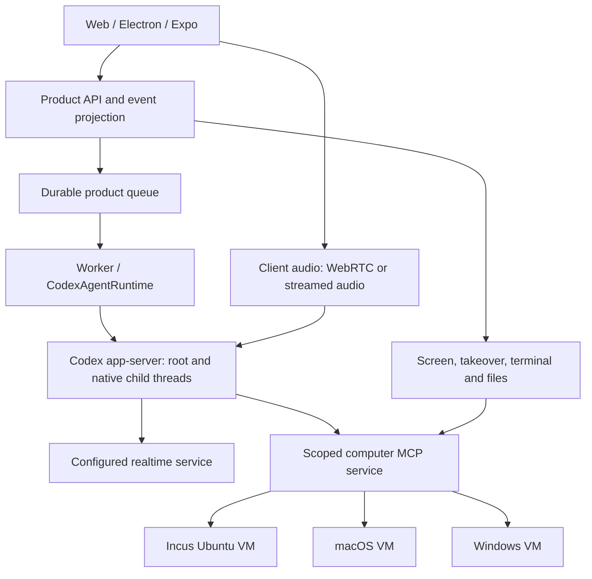

# Codex runtime and self-hosted computers

Status: live chain and scoped worker-crash recovery accepted, 2026-10-16. The real API and independent worker
delegated to a native Codex child on a temporary Incus Ubuntu VM, verified its nonce
through external readback, and retained the same native root after restarting the
worker between completed turns. The real web root/child tree was visually verified
in the viewport before and after refresh. Three command-operation crash windows
were also accepted using real worker SIGKILL and independent VM readback. Each
recovered the original run and native IDs with exactly one file append. API/web
cold restart and fresh browser login retained the recovered tree and states.
Arbitrary GUI transactions, VM power loss, native apps and other guest operating
systems remain outside this acceptance.
See [current status and configuration](codex-fork-status.md).
No fork release or live Codex voice acceptance is available. Preserve the upstream
Apache-2.0 license and attribution.

## Decision and ownership

Use Rakazo's web, Electron and Expo clients and its product services. Use Codex
app-server for the root conversation, model loop, persisted history, compaction,
native child agents, interruption and synthesis. Product services own identity,
authorization, delivery, schedules, audit and the presentation of runtime events.
The computer service owns target routing and execution, without another model loop.



“Codex-owned” describes the agent runtime. Clients still implement audio capture,
playback and UI. Guest drivers still implement screenshot, input and execution.
Realtime model availability and authentication must be verified separately from
the text model connection.

## What the interfaces establish

| Capability | Evidence | Integration work |
| --- | --- | --- |
| New independent conversations | `thread/start`, `thread/resume`, `thread/fork` are app-server methods | Persist product-to-Codex IDs and state directories; expose authorized thread management |
| Native subagents | Native spawn/wait/message/close handlers exist in Codex | Enable the tested runtime features; route child events and inherited tools; preserve actual parent/child IDs |
| Browser interaction | Desktop documentation requires a browser surface or extension | Supply a browser driver through scoped MCP tools; keep its profile, permissions and target explicit |
| Computer interaction | Desktop documentation requires the Computer Use plugin and OS permissions | Supply guest screenshot/input drivers; a feature flag or policy object alone is insufficient |
| Realtime voice | Experimental `thread/realtime/*` requests/events; WebRTC and WebSocket transports | Capture/play audio, relay signaling/events, validate upstream access, interruption and delegation |

Creating an independent thread through the client API is distinct from a model
spawning a native child. A root can coordinate its children through Codex's tools.
Managing other product conversations requires an explicitly scoped thread-control
tool; knowing a thread ID must not grant authority over it.

The probe exercises initialize, two independent thread creations and the local
voice catalog. It inspects generated schemas for resume, fork, turns and realtime.
It does **not** prove model execution, native delegation, durable resume or a voice
call. Native delegation and completed-turn restart recovery have now also passed
through this fork's real API/worker, beyond the earlier separate PAC integration.

## Runtime integration rules

- Preserve a stable Codex thread and its state directory across worker restarts.
  UI transcripts are projections; do not resubmit old messages as new prompts.
  The current adapter stores bindings under `DATA_DIR/codex-sessions`. The first
  live recovery gate covered a restart between completed turns; a later gate
  covered three mid-turn command crash windows. A durable controller journal and
  VM execution receipt distinguish prepared, dispatched and completed operations.
  A dispatched operation is never automatically resent. Unknown outcomes block
  new mutations; reporting-only recovery cannot dispatch new child work or tools.
  Operator resolution of genuinely unknown outcomes has no product UI yet.
- Route events by thread/turn/request ID. A child event is not a root-thread
  identity error. Only accept descendants established by trusted runtime events.
- Keep pending approvals bound to the original request and process connection.
  Reconnect or interruption must not replay a side-effecting tool call.
- Product queues deliver or steer input. They do not compete with an active
  Codex turn or recreate a Pi loop around Codex responses.
- Start with the already exercised MCP computer-tool approach. Validate native
  child inheritance and authorization before expanding to other tool transports.
- The controller's shell is not a selected VM's shell. Initially route guest
  commands and files through scoped tools and restrict controller execution.
- Choose a pinned runtime by acceptance results. The local protocol probe passed
  with `codex-cli 0.147.0`; upstream Rakazo's draft adapter pins a different version.
  Generate schemas from the deployed binary; do not mix protocol snapshots.

Upstream draft PR #1400 is useful reference material, not a complete drop-in
runtime: at the inspected revision it disables native multi-agent features and
rejects events whose thread ID differs from the root. Do not import the entire
draft or enable its flags without fixing event routing and child authorization.

## Computer integration rules

Keep virtualization backend, guest OS and execution capabilities independent.
Register each computer with a stable identity, lifecycle backend, guest OS,
driver connection and measured capabilities. Select by computer identity, not a
single global sandbox provider setting.

Start with an existing Incus Ubuntu VM and the PAC execution path. Add macOS and
Windows through their actual host managers and guest drivers. Incus guest-agent
command/file support does not establish GUI support. Validate the macOS logged-in
desktop and permissions; run Windows GUI operations in an interactive user session.

The initial Incus adapter attaches only to instances in a deployment-owned JSON
allowlist. It does not create desktops. Its current capabilities include guest
commands, files, screenshots and GUI actions; PTY, screen streaming/takeover,
snapshots and multiple screens are unsupported. These are implementation boundaries
to close after the first real product acceptance, not capabilities implied by the
upstream client UI.

Enforce per-thread computer grants in the service. The model cannot enlarge them
by supplying a different ID. Default to one input writer per interactive desktop;
use separate VMs for parallel children. Human takeover revokes the agent's current
write lease, including already queued input. Advertise terminal, GUI, snapshot,
takeover and multi-screen support per computer, with unsupported operations explicit.

Screen viewers can reuse the client containers. A backend using RDP or another
transport needs a compatible browser gateway; a raw remote-desktop URI is not a
noVNC connection. Cross-OS artifacts are explicit file transfers. VM disk snapshots
and browser profiles are not assumed portable between operating systems.

## Realtime voice

Bind voice to the same Codex thread used by typed input. For WebRTC, the client
creates an offer and app-server returns SDP through realtime events. For WebSocket
audio, use the runtime's audio chunk schema and output audio events. Keep device
permissions and audio playback in the client. Let Codex handle voice-to-work
delegation; do not create a parallel planner to emulate it.

Enable the experimental API and the selected runtime's realtime feature gate.
Verify the configured realtime endpoint, model, auth mode and account entitlement.
A successful `listVoices` call is a catalog check, not authentication or call
acceptance. A Responses-compatible text proxy is not automatically a realtime
proxy. Keep long-lived credentials on the control side; clients receive only the
connection material appropriate to their transport.

## Ordered acceptance gates

1. **Codex + Ubuntu through Rakazo.** Native delegation, guest tool marker write,
   independent readback, durable/web tree identity and same-root worker recovery
   between completed turns passed on 2026-10-16. Viewport tree screenshots before
   and after refresh were visually accepted. Three worker SIGKILL windows now also
   pass: before dispatch, after VM execution before result receipt, and after
   durable result storage before returning it to Codex. Every command appended
   exactly once. Approval recovery, arbitrary GUI effects and VM power loss are
   separate, unaccepted cases.
2. **Mixed computers.** One root delegates work to Ubuntu, macOS and Windows.
   Independently read back each artifact; test routing, screen input, takeover,
   locked/logged-out desktops and unavailable capabilities.
3. **Realtime + existing work.** A real microphone call starts on the same thread,
   produces audible output, accepts interruption, delegates a task and reports its
   result while conversation continues. Verify disconnect/reconnect and both text
   and voice steering. Do not substitute transcription-plus-TTS for this gate.
4. **Client recovery.** The real web client passed refresh and API/web cold restart
   with fresh login after worker-crash recovery. Native desktop/mobile sessions,
   approval recovery and VM restarts still need their own acceptance.

## Reproduce the narrow protocol check

```sh
node scripts/probe-codex.mjs /absolute/path/to/codex
```

The script uses temporary HOME/CODEX_HOME directories, a minimal environment and
a loopback model-provider URL. It sends no model turn, audio or realtime start
request. It prints a path-free JSON receipt distinguishing schema availability
from exercised behavior, terminates its app-server and removes temporary state.
No package installation or running Rakazo stack is required. A nonzero exit means
the required probe contract failed; do not report it as full runtime acceptance.

## Source anchors

- [Codex app-server protocol](https://learn.chatgpt.com/docs/app-server)
- [Codex realtime protocol, inspected source](https://github.com/openai/codex/blob/e790ce271749ce431e446a9e2cc66485fe60f931/codex-rs/app-server-protocol/src/protocol/v2/realtime.rs)
- [Codex realtime runtime, including authentication and delegation](https://github.com/openai/codex/blob/e790ce271749ce431e446a9e2cc66485fe60f931/codex-rs/core/src/realtime_conversation.rs)
- [Browser surface](https://learn.chatgpt.com/docs/browser) and [Computer Use setup](https://learn.chatgpt.com/docs/computer-use)
- [Rakazo draft Codex adapter, inspected revision](https://github.com/elie222/rakazo/blob/6c4e0f16767bd9656551a6b29cb0d8d1b5119fc9/packages/adapters/src/primary-harness-codex.ts)
- [Rakazo runtime and sandbox contracts, baseline](https://github.com/elie222/rakazo/blob/7d5e64c886da7d556673f99e4923b013315007a9/packages/adapter-kit/src/interfaces.ts)
- [Incus guest agent installation](https://linuxcontainers.org/incus/docs/main/howto/instances_create/#install-the-incus-agent-into-virtual-machine-instances)
